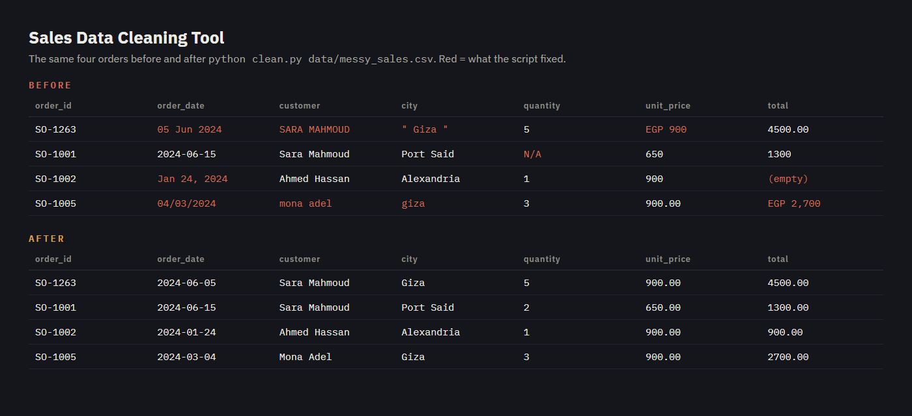
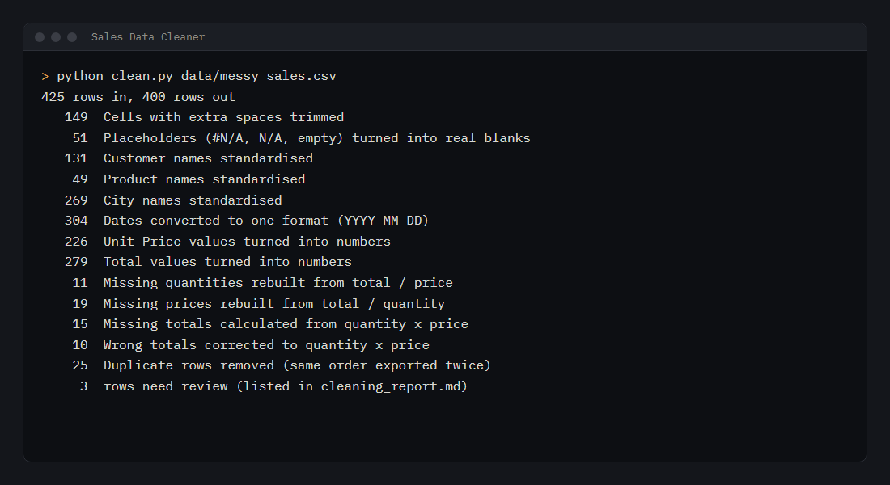

# Sales Data Cleaning Tool

Turns a messy sales export into a clean, analysis-ready file, and writes a report of every change it made.



## The problem

Sales data exported from shops, spreadsheets and old systems is rarely ready to use. In one file you get
dates written four different ways, prices typed as `EGP 1,200`, the same city spelled `Alex`, `alex ` and
`Alexandria`, `#N/A` where a value was lost, totals that don't match quantity × price, and the same order
exported twice. Any report built on that file is wrong before anyone looks at it.

## What it does

| Problem | Fix |
|---|---|
| Extra and repeated spaces | Trimmed in every cell |
| `#N/A`, `N/A`, `-`, empty cells | Turned into real blanks, so they're never counted as values |
| Names in random case (`SARA MAHMOUD`, `mona adel`) | Standardised to `Sara Mahmoud` |
| City spellings (`Alex`, `PortSaid`, `El Mansoura`) | Mapped to one name per city |
| Dates in several formats (`05/01/2024`, `5 Jan 2024`, `Jan 5, 2024`) | Converted to `YYYY-MM-DD` (slashes read day-first) |
| Money typed as text (`EGP 1,200`, `1200.00`) | Converted to numbers |
| One of quantity, price or total missing | Rebuilt from the other two |
| Total that doesn't match quantity × price | Corrected |
| The same order exported twice | Duplicate removed |

Nothing is dropped silently. If a row can't be fixed with certainty (for example both the price and the
total are missing), it stays in the output and is listed in the report under **Needs review**.

## Run it

```bash
pip install -r requirements.txt
python make_messy_data.py              # creates data/messy_sales.csv (425 messy rows)
python clean.py data/messy_sales.csv   # writes output/clean_sales.csv, .xlsx and cleaning_report.md
```

To clean your own file: `python clean.py path/to/export.csv --out results`. The columns it expects are
`order_id, order_date, customer, city, product, quantity, unit_price, total`.



## Result on the sample data

425 rows in, 400 clean rows out: 25 duplicates removed, 304 dates converted, 45 missing values rebuilt,
10 wrong totals corrected, and 3 rows flagged for review. The full report is in
[`output/cleaning_report.md`](output/cleaning_report.md).

## Tests

```bash
pytest
```

The tests check every date format, money parsing, and that the cleaned output is consistent: no duplicates,
every date readable, every total equal to quantity × price, one spelling per city.

## Built with

Python · pandas · openpyxl (Excel output) · pytest
